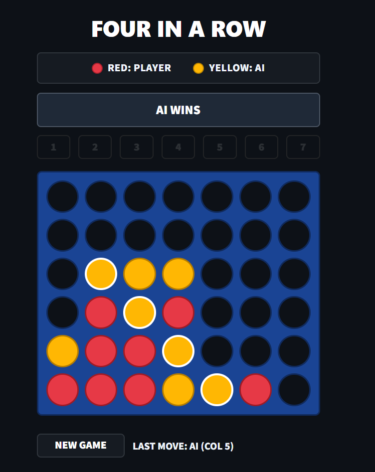

# Four in a Row

A web-based implementation of Connect Four built with Python and Streamlit. The game features a custom dark-mode UI and an AI opponent powered by the Minimax algorithm with Alpha-Beta pruning.

## Live Demo

**[Play the Live App on Streamlit](https://four-in-a-row.streamlit.app/)**


## Overview

In this version of Four in a Row, the human player (Red) always takes the first turn against the AI (Yellow) on a standard $6 \times 7$ vertical grid. Players can drop discs either by clicking directly on any slot in the target column or by using the numbered column buttons (`1`–`7`).

## Screenshot

<p align="center">
  
</p>

## Key Features

* **Interactive Board UI:** Custom CSS styling with direct column-click support and winning-line highlights.
* **Minimax AI with Alpha-Beta Pruning:** Searches 6 plies deep to evaluate optimal moves and counter-threats.
* **Search Optimizations:** Uses center-outward move ordering (`[3, 2, 4, 1, 5, 0, 6]`) and a transposition table cache to prune branches efficiently.
* **Positional Heuristic:** Evaluates board states based on center-column control, immediately playable threats (gravity-supported slots), and row parity.

## Project Structure

```text
├── app.py              # Streamlit frontend and UI styling
├── backend.py          # Game mechanics and Minimax AI engine
├── assets/
│   └── game_4.png      # Gameplay screenshot used in README
├── requirements.txt    # Python dependencies
└── README.md           # Project documentation
```

## Running Locally

1. **Clone the repository:**
   ```bash
   git clone https://github.com/Saish-4593/Four-in-a-Row.git
   cd four-in-a-row
   ```

2. **Install dependencies:**
   ```bash
   pip install -r requirements.txt
   ```

3. **Start the Streamlit server:**
   ```bash
   streamlit run app.py
   ```